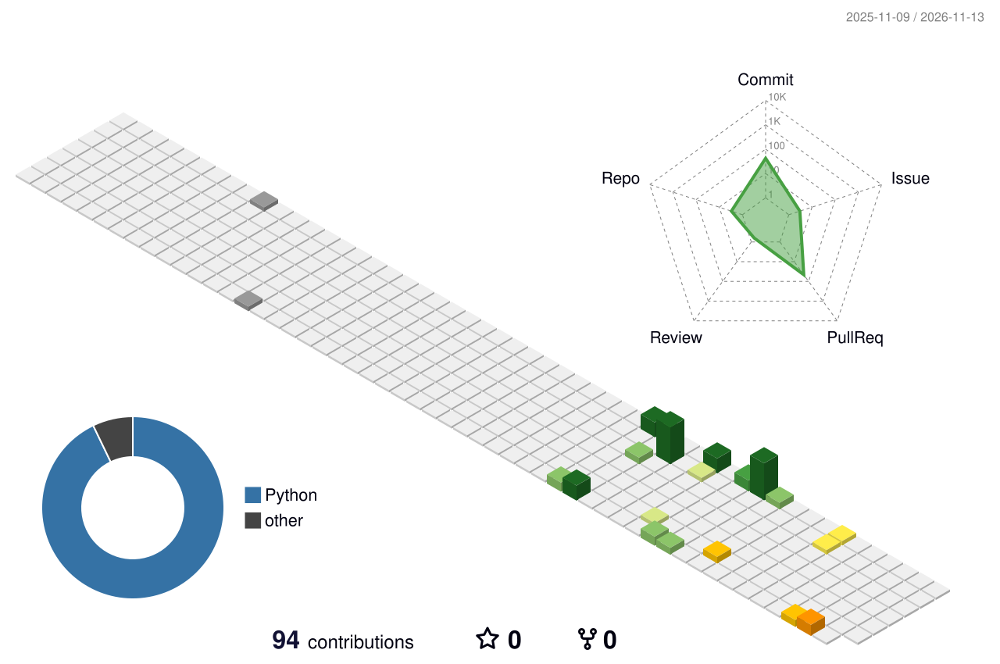

# Hi, I'm Yuki Tsuda! 👋

I'm interested in Python, machine learning, and building data-driven applications.

## Featured Projects

### [Keiba AI Pro](https://github.com/yuki20001105/keiba-ai-pro)
A horse-racing prediction application with race data collection, feature engineering, machine-learning model training, and race analysis.

### [SIGNATE 2025 S Cup](https://github.com/yuki20001105/signate_2025_sCup)
My project for the SIGNATE 2025 S Cup competition.

## Skills

- **Languages**: JavaScript, Python, Java
- **Frameworks**: React, Node.js, Django, FastAPI, Streamlit
- **Tools**: Git, Docker, VS Code

## GitHub Stats

  
  

  

## GitHub Metrics

**Scope limitation:** With the automatic `GITHUB_TOKEN`, Metrics can only analyze
this profile repository, not all of my public repositories. Repository-based
totals, languages, and issue/pull-request follow-up are therefore limited to
`yuki20001105/yuki20001105`; the existing stats cards above remain separate.
Achievements are disabled because Metrics v3.34 queries the retired GitHub
Projects (classic) API. No personal access token is used.

## 3D Contribution Graph

<picture>
  <source media="(prefers-color-scheme: dark)" srcset="./profile-3d-contrib/profile-night-rainbow.svg" />
  <source media="(prefers-color-scheme: light)" srcset="./profile-3d-contrib/profile-season-animate.svg" />
  
</picture>

Generated from publicly accessible GitHub information using the automatic `GITHUB_TOKEN`.
Updates are scheduled daily at 00:00 UTC (09:00 JST), and can also be run manually from Actions.